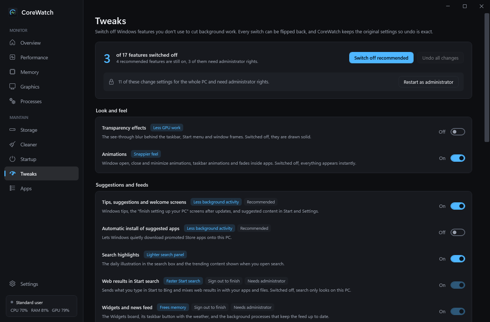
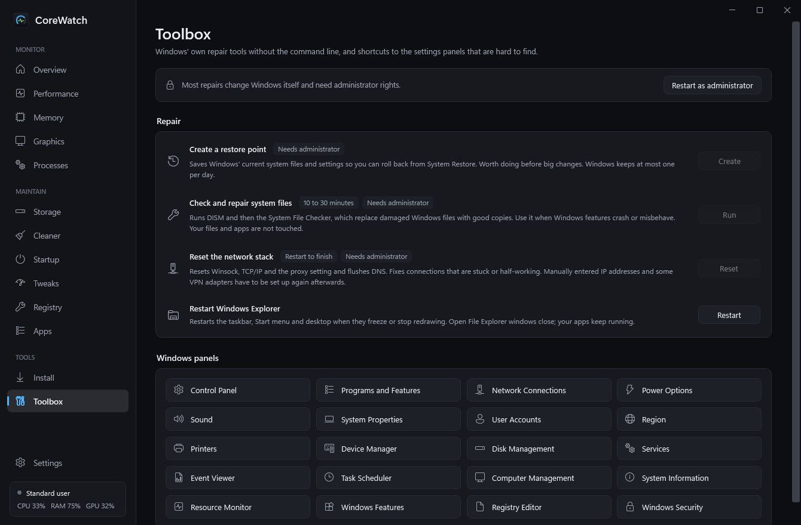

# CoreWatch

A native Windows system manager: live monitoring of CPU, memory, GPU and disks, plus the maintenance tools you would otherwise need several utilities for. Built with C# and WPF on .NET 10, with one NuGet dependency and no third-party UI libraries.



## Download

Get the latest build from the [Releases page](https://github.com/haych-dev/CoreWatch/releases/latest):

- **`CoreWatch-<version>-win-x64-standalone.exe`** runs on its own; nothing else to install.
- **`CoreWatch-<version>-win-x64.exe`** is under 1 MB but needs the [.NET 10 Desktop Runtime](https://dotnet.microsoft.com/download/dotnet/10.0).

There is no installer: download the exe and run it. The exe is not code-signed, so Windows SmartScreen may show a warning the first time.

## What it does

**Monitor**

- **Overview**: gauges for CPU, memory, GPU, video memory and the system drive, an activity chart, insights, and a one-click **Refresh PC**.
- **Performance**: CPU history, a tile per logical core, network and disk throughput.
- **Memory**: in use / modified / standby / free breakdown, commit and page file, top consumers by app.
- **Graphics**: a card per GPU with utilization, video memory and (NVIDIA) temperature, fan and power; video memory by app.
- **Processes**: sortable, filterable list with end task and end process tree.

**Maintain**

- **Storage**: volumes, physical disk health, and a space analyzer with a treemap and largest-files list.
- **Cleaner**: temp files, caches and leftovers across Windows, browsers and developer tools.
- **Startup**: switch sign-in apps on or off, the same way Task Manager does.
- **Tweaks**: switch off Windows features you don't use. Original settings are saved so undo is exact.
- **Registry**: find entries left behind by programs that are gone. A `.reg` backup is written before anything is removed.
- **Apps**: installed apps by size, with uninstall.

**Tools**

- **Install**: pick apps from a catalogue and install them through winget.
- **Toolbox**: restore point, system file repair (DISM and SFC), network reset, Explorer restart, and shortcuts to Windows panels.



## Safety

- Security features are left alone: no switches for Microsoft Defender, Windows Update, the firewall, SmartScreen or UAC.
- Tweaks and registry fixes are reversible from inside the app.
- **Cleaner deletes permanently**, after a confirmation. Temp files newer than 24 hours are kept by default.
- Registry findings are only listed when they name a full path on a fixed drive that Windows reports as not found.
- Anything that changes Windows for all users needs CoreWatch to run as administrator; it says so and offers to restart elevated.

This is a personal project. Parts of it have only been tested on one PC, so read what a button says before pressing it.

## Requirements

- Windows 10 or 11, x64
- [.NET 10 Desktop Runtime](https://dotnet.microsoft.com/download/dotnet/10.0) to run, or the .NET 10 SDK to build
- winget (App Installer) for the Install page

## Build and run

```
dotnet build -c Release
bin\Release\net10.0-windows\win-x64\CoreWatch.exe
```

Single-file executable:

```
dotnet publish -c Release -p:PublishSingleFile=true --self-contained false -o publish
```

## Credits

The cleaner was inspired by [FluentCleaner](https://github.com/builtbybel/FluentCleaner), and the Install and Toolbox pages by [winutil](https://github.com/ChrisTitusTech/winutil). No code from either project is used.

## Licence

[MIT](LICENSE)
